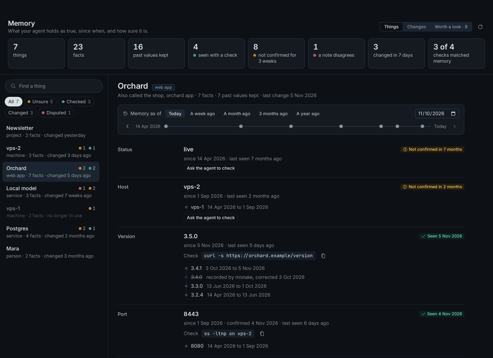
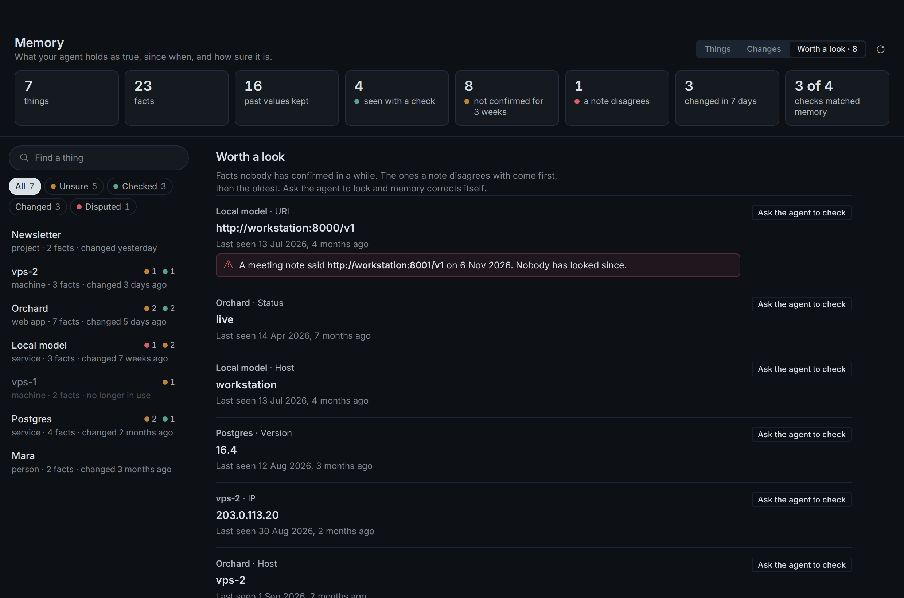
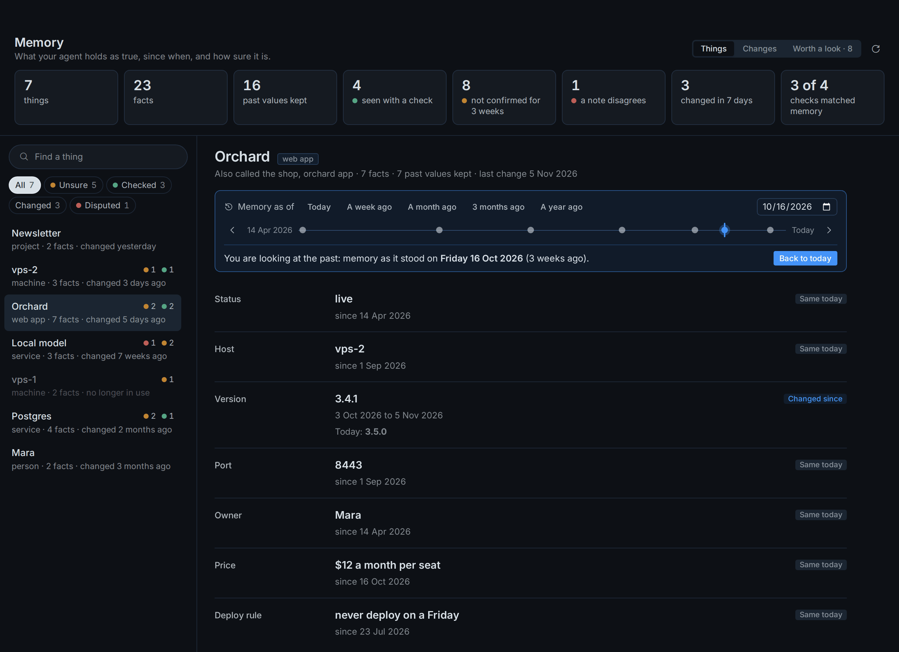

# Deltos for Hermes

**Memory that knows what's true now, what it used to be, and when it hasn't checked lately.**

A memory provider for Hermes. For every thing in your world (a server, an app, a
person, a project) it keeps the value that is true now, the day it became true and
every value it replaced, as plain markdown you can read, edit and diff. No
embeddings, no index server, no model on the read path, no Python dependencies.

An agent's worst memory failure isn't "I don't know". It is answering with full
confidence the value that changed last week. So Deltos does three things a prompt
or a skill can't:

- **It keeps time.** A new value replaces the old one and the old one stays, with
  its dates. "What port was it on in August?" has an answer.
- **It says when it hasn't checked.** A host, port, version or status nobody has
  confirmed in three weeks reaches the agent marked `not confirmed in 2 months`,
  with how to look again when memory knows a way.
- **It learns from looking.** When the agent looks, it tells memory what it saw and
  how. Memory confirms the value or replaces it, and keeps the score of how often
  it was right.

What the agent reads on a turn that asks "Which host is Orchard on?" (from the
made-up store below):

```
Profile entries [orchard · last edited 2026-11-05]:
- **Host:** vps-2 (since 2026-09-01; source: demo; not confirmed in 2 months)
  - was: vps-1 (2026-04-14 to 2026-09-01)
- **Deploy rule:** never deploy on a Friday (since 2026-07-23; source: demo)
```

## Install

```bash
hermes plugins install deltos --enable
hermes plugins enable deltos      # lets the Memory page read the store
hermes memory setup deltos        # one question: the folder to keep memory in
```

Then start a new session (restart the gateway if one is running). Until the
catalog lists it, the first line is
`hermes plugins install CocaKova/deltos#adapters/hermes/deltos --enable`.

Needs Hermes 0.22.5 or newer and Python 3.11 or newer. Nothing else: no account,
no key, no service, no packages. [ripgrep](https://github.com/BurntSushi/ripgrep)
is used when it is installed and is not needed. Hermes runs one external memory
provider at a time, so this takes the place of another one.

A new store starts with the "not confirmed" note at 21 days and checks on
(`deltos.toml` in the memory folder; edit it freely). A store you already have is
left exactly as it is.

## What you get

**In every turn.** The memory block for the message, built from the files in well
under a second: the things the message names, their current values with dates and
a short trail of what they were, and the pages that match.

**Tools for the agent.** `remember` (a fact, the moment it changes; with `check`,
how the agent just saw it), `name_thing`, `forget`, `memory_restore`,
`memory_recall`, `memory_show`, `memory_checks` (what is due for a fresh look),
and pages for what isn't a fact: `page_search`, `page_read`, `page_write`,
`page_edit`, `page_forget`. A write lands in memory at once, with no model and no
background run.

**`/deltos` in any chat.** Answered from the files, without a model turn:

```
/deltos                       how much memory holds, what it has not confirmed, what changed lately
/deltos Orchard               one thing: each value, since when, and what it was before
/deltos on 2026-08-15 Orchard what was true of it on that day
/deltos changes 30            what changed in the last 30 days
/deltos due                   what is worth a fresh look, most pressing first
```

```
**Memory** · 7 things, 23 entries, 16 past values kept
8 not confirmed in 3 weeks or more · 4 seen with a check · 1 a note disagrees with
Last 7 days: 3 entries changed on 3 things; 8 due for a look
Looks in the last 90 days: 4; memory was right 3 of 4 times it already had a value
```

**A Memory page in Hermes Desktop.** Every thing memory knows, each fact with the
date it became true and the values it held before, the ones nobody has confirmed in
a while, what changed this week, and a day picker that shows what memory held as
true on any past day. It is read-only: its one button puts "please check this" in
the chat box for you to send.
Installing from the Desktop app turns the page on with the plugin. After a
command-line install, switch Deltos on once in the app's Plugins list. The page
reads memory through the plugin, which is what `hermes plugins enable deltos` is for.







The pictures show the made-up store below, drawn by the page's own test harness
(`tests/desktop/harness` in the repo).

**`hermes deltos` in a terminal.** `hermes deltos` prints the same overview, and
`hermes deltos <command>` is the whole deltos command line on this profile's store
(`show`, `remember`, `checks`, `doctor`, `status`, ...).

## Try it on a made-up store

```bash
hermes deltos demo ~/deltos-demo
DELTOS_ROOT=~/deltos-demo hermes deltos
DELTOS_ROOT=~/deltos-demo hermes deltos view Orchard
```

A two-person studio's memory over seven months: values that changed, values
someone checked, values nobody has confirmed in weeks, one a meeting note
disagrees with, one recorded by mistake. Start Hermes with
`DELTOS_ROOT=~/deltos-demo` to chat against it. Nothing in it is real.

## Settings

| Where | What |
|---|---|
| `hermes memory setup deltos` | the memory folder, saved in `deltos.json` in the Hermes home (each profile can have its own) |
| `DELTOS_ROOT` | the memory folder, when set (wins over setup; default `~/deltos`) |
| `DELTOS_AGENT` | the name recorded as the source of what the agent writes |
| `DELTOS_SRC` | a deltos checkout to run instead of the copy inside the plugin |
| `<folder>/deltos.toml` | everything else: see the [main README](https://github.com/CocaKova/deltos#configuration) |

## What it does on your machine

- **Files.** Reads and writes its memory folder, and `deltos.json` in the Hermes
  home. It writes a read log there, `reads/<month>.jsonl`: one line per memory
  block with sizes, timing and the names of the things shown, never the message
  text.
- **Other folders, only the ones you name.** `[pages]` folders the agent may read
  or edit, `[import]` note folders, and `[sessions] hermes`, which reads Hermes'
  own chat history for the daily digests and for learning.
- **Network: none by default.** Reading memory, writing facts, `/deltos` and the
  page never call anything. Two optional features call the one model endpoint you
  configure under `[llm]` (its key is read from an environment variable you name):
  `deltos import` (your notes into facts) and learning from chats.
- **Commands it runs.** `rg` for search when installed, and `git` when a note
  folder or the memory folder is a git repo. A `check:` line is text for the
  agent; Deltos never runs it.
- **Background process: none by default.** With `[learn] auto = true` the plugin
  starts `deltos learn --wait` when a session ends, which waits until the agent is
  idle and sends one model request at a time.
- **Your own code, only if you ask.** `[hermes] extra_block` names a Python file of
  yours whose `build_block()` is added to the instructions. Unset by default.
- It is fail-soft: a memory error gives an empty block, never a failed turn.

**Learning from chats is experimental and off.** It turns finished chats into
facts with your model. On real chats it has kept too many lines that were trivia
or wrong to be on by default; the measurements are in the main README. Every
import or learn sweep is a staged run that is checked before it touches memory and
can be undone (`hermes deltos status`, `hermes deltos run undo <id>`).

## How well it remembers

On 332 held-out LongMemEval questions Deltos answered 295 right (88.9%) against
254 for plain search, and on the questions other systems were run on, 90 of 100
against Mem0's 82 and 44 of 50 against Graphiti's 19. Single runs, with one local
model answering and grading; the details, the misses and what not to conclude are
in the [main README](https://github.com/CocaKova/deltos#results).

MIT. Source, benchmarks and the file format:
[github.com/CocaKova/deltos](https://github.com/CocaKova/deltos).
